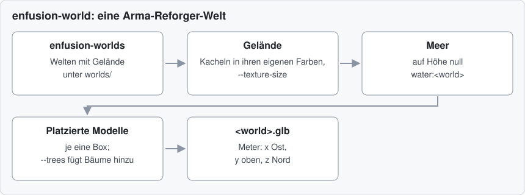

# Arma-Reforger-Welten: `worlds` und `world` {#arma-reforger-worlds-worlds-and-world}

**Was ist das?** Eine ganze Arma-Reforger-Welt als eine 3D-Datei. **Warum?** Damit
die Hitze aus dem Spiel das Gelände und die Gebäude darunter hat. (*Enfusion* ist die
Engine, mit der Arma Reforger gemacht ist; eine *Welt* ist das, was das Spiel eine
Karte nennt.)

Exportiert eine ganze Enfusion-Welt des installierten Arma Reforger: das Gelände in
den Farben seiner eigenen Supertexture-Kacheln, das Meer und jedes platzierte Modell
als Box, in den eigenen Metern des Spiels. `worlds` und `world` antworten auch auf die
Namen, die 3DHeat GameFiles ihnen gab, `enfusion-worlds` und `enfusion-world`, mit
denselben Optionen.



## Schritt für Schritt {#step-by-step}

1. **Die Welten auflisten**, die ein Gelände haben. Die erste Zeile sagt, wo das Spiel
   gefunden wurde:

   ```
   heat3d-reforger-maps worlds
   heat3d-reforger-maps worlds --install "D:\Games\Arma Reforger"
   ```

2. **Eine exportieren**, unter ihrem Ordnernamen in `worlds/`, wie aufgelistet:

   ```
   heat3d-reforger-maps world <world> -o world.glb
   ```

3. **Varianten:**

   ```
   heat3d-reforger-maps world <world> --trees               # vegetation too, as boxes
   heat3d-reforger-maps world <world> --texture-size 0      # flat colour, small file
   heat3d-reforger-maps world <world> --ground-spacing 4 --no-structures
   ```

4. **`world.glb` öffnen** im Bereich Hintergrund / Level des 3DHeat-Viewers
   ([Level laden](https://holdi601.github.io/3DHeat/levels.html)).

## Optionen {#options}

| Option | Vorgabe | Bedeutung |
|---|---|---|
| `<world>` | Pflicht | eine Welt, so wie `worlds` sie ausgibt |
| `-o`, `--out FILE` | `<world>.glb` (in `$HEAT3D_LEVELS/<game>/`, wenn das gesetzt ist) | die zu schreibende Datei |
| `--install FOLDER` | die Steam-Bibliothek, die das Spiel enthält (`steamapps\common\Arma Reforger`) | der Ordner des Spiels: der mit `addons` darin |
| `--ground-spacing METRES` | 2 (das eigene des Geländes) | der Abstand der Geländepunkte in der Datei |
| `--texture-size PIXELS` | 4096 | die größere Seite des Bildes der Bodenfarbe; 0 für einfarbige Flächen |
| `--no-structures` | | die platzierten Modelle weglassen |
| `--trees` | aus | auch Bäume und andere Vegetation platzieren, als Boxen |

## Beispielausgabe {#example-output}

`worlds`:

```text
Arma Reforger at D:\Games\Steam\steamapps\common\Arma Reforger: <n> worlds with a terrain
  <world>                                  worlds/<world>/.../<world>.terr
  ...
```

`world`, nach einer Zeile pro Schritt (`<world>: reading ...`):

```text
<world> -> world.glb
  ground      <n> triangles, <w> x <h> m; <n> of <n> tile-edge vertices disagree; colour <w> x <h>
  structure   <n> boxes from <n> entities
  water       <n> triangles (the sea)
  left out    <what>: <n>, ...
```

## Die Teile {#the-parts}

`ground:<world>` (das Gelände), `water:<world>` (das Meer, auf Höhe null) und
`structure:<world>` (die Boxen). Die Koordinaten sind die des Spiels: x nach
Osten, y nach oben, z nach Norden, in Metern, also das, was eine Aufnahme aus dem
Spiel meldet. Das Bezugssystem des Spiels ist linkshändig. *Weltachse invertieren* im
Viewer zeigt es ungespiegelt.

## Wie es gelesen und geprüft wird {#how-it-is-read-and-checked}

Keine Workbench nötig, und nichts ist verschlüsselt.

| Format | Was es ist | Geprüft gegen |
|---|---|---|
| `.pak` | ein Datenchunk und ein Verzeichnisbaum, Einträge gespeichert oder zlib | der Baum verbraucht seinen Chunk genau; stichprobenartig geprüfte zlib-Einträge entpacken auf genau ihre angegebene Größe |
| `.edds` | eine DDS-Kopfzeile, dann pro Mip-Stufe `COPY`- oder `LZ4 `-Chunks | aufgeteilte Stufen dekodieren auf genau ihre Größe und verwenden genau ihre Bytes |
| `.terr` / `.ttile` | eine Kopfzeile und Kacheln mit 16-Bit-Höhen | jede gemeinsame Kachelkante stimmt genau überein |
| Supertexture | die Bodenfarbe jeder Kachel, etwa ein Meter pro Pixel | sie passt zum Meer in den Höhen; keine Spiegelung oder Transposition passt besser |
| `.ent` | Namen, Ressourcen-GUIDs, dann Entitäten als typisierte Werte | eine Weltdatei parst bis zu ihrem letzten Byte |
| `resourceDatabase.rdb` | GUID zu Pfad | fast jede GUID, die eine Welt verwendet, nennt eine Datei, die existiert |

Objekte, die als auf absoluter Höhe stehend markiert sind, sitzen auf wenige
Zentimeter genau auf dem dekodierten Gelände (mit vertauschtem Raster lägen sie um
mehrere Meter daneben). Nicht gezeichnet: die eigenen Dreiecke der Modelle, Bäume standardmäßig
(`--trees` fügt sie als Boxen hinzu), untergeordnete Entitäten, Seen und Flüsse,
Texturen mit Kopfzeilen vor DX10.

**Bedingungen:** Das Werkzeug liest die Dateien deiner eigenen Installation; die Ausgabe ist für deinen eigenen Gebrauch bestimmt und wird nicht weitergegeben ([Bedingungen und Lizenz](terms.md)).

## Meldungen und Exit-Status {#messages-and-exit-status}

| Meldung | Exit | Bedeutet |
|---|---|---|
| `Arma Reforger not found; pass --install <game folder>` | 2 | Das Spiel über Steam installieren oder `--install` angeben |
| `no world '<name>'; there are: ...` | 2 | Der Name steht nicht in der Liste von `worlds`; die Zeile nennt die vorhandenen |
| `needs 3DHeat GameFiles: ...` | 2 | 3DHeat GameFiles installieren ([Vor dem Start](before-you-start.md)) |
| alles andere | 1 | Ein Archiv oder eine Datei konnte nicht gelesen werden; die Zeile sagt welche |

0 heißt: Die Welt wurde geschrieben; ihr Bericht beginnt mit `<world> -> <file>`.

## Mit 3DHeat GameFiles {#through-3dheat-gamefiles}

Die eigenen `enfusion-worlds` und `enfusion-world` von 3DHeat GameFiles führen dieses
Werkzeug mit denselben Argumenten aus, daher tut `python -m heat3d_gamefiles
enfusion-world <world>` dasselbe, sobald beide installiert sind.
