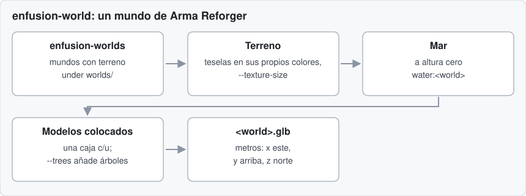

# Mundos de Arma Reforger: `worlds` y `world` {#arma-reforger-worlds-worlds-and-world}

**¿Qué es?** Un mundo completo de Arma Reforger como un único archivo 3D. **¿Para qué?** Para que el calor del juego tenga debajo el suelo y los edificios. (*Enfusion* es el motor con el que está hecho Arma Reforger; un *mundo* es lo que el juego llama mapa.)

Exporta un mundo Enfusion completo de Arma Reforger instalado: el terreno con los colores de sus propias losetas de supertextura, el mar, y cada modelo colocado como una caja, en los metros propios del juego. `worlds` y `world` también responden a los nombres que les dio 3DHeat GameFiles, `enfusion-worlds` y `enfusion-world`, con las mismas opciones.



## Paso a paso {#step-by-step}

1. **Listar los mundos** que tienen terreno. La primera línea dice dónde se encontró el juego:

   ```
   heat3d-reforger-maps worlds
   heat3d-reforger-maps worlds --install "D:\Games\Arma Reforger"
   ```

2. **Exportar uno**, por el nombre de su carpeta dentro de `worlds/` tal como aparece en la lista:

   ```
   heat3d-reforger-maps world <world> -o world.glb
   ```

3. **Variantes:**

   ```
   heat3d-reforger-maps world <world> --trees               # vegetación también, como cajas
   heat3d-reforger-maps world <world> --texture-size 0      # color plano, archivo pequeño
   heat3d-reforger-maps world <world> --ground-spacing 4 --no-structures
   ```

4. **Abre `world.glb`** en el panel de Fondo / nivel del visor de 3DHeat ([cargar un nivel](https://holdi601.github.io/3DHeat/levels.html)).

## Opciones {#options}

| Opción | Por defecto | Significado |
|---|---|---|
| `<world>` | obligatorio | un mundo tal como lo imprime `worlds` |
| `-o`, `--out FILE` | `<world>.glb` (en `$HEAT3D_LEVELS/<game>/` cuando está definido) | el archivo que se escribe |
| `--install FOLDER` | la biblioteca de Steam que tiene el juego (`steamapps\common\Arma Reforger`) | la carpeta del juego: la que tiene `addons` dentro |
| `--ground-spacing METRES` | 2 (el propio del terreno) | la separación de vértices del terreno en el archivo |
| `--texture-size PIXELS` | 4096 | el lado mayor de la imagen de color del suelo; 0 para color plano |
| `--no-structures` | | deja fuera los modelos colocados |
| `--trees` | desactivado | coloca también árboles y otra vegetación, como cajas |

## Salida de ejemplo {#example-output}

`worlds`:

```text
Arma Reforger at D:\Games\Steam\steamapps\common\Arma Reforger: <n> worlds with a terrain
  <world>                                  worlds/<world>/.../<world>.terr
  ...
```

`world`, con una línea por paso (`<world>: reading ...`):

```text
<world> -> world.glb
  ground      <n> triangles, <w> x <h> m; <n> of <n> tile-edge vertices disagree; colour <w> x <h>
  structure   <n> boxes from <n> entities
  water       <n> triangles (the sea)
  left out    <what>: <n>, ...
```

## Las partes {#the-parts}

`ground:<world>` (el terreno), `water:<world>` (el mar, a altura cero) y `structure:<world>` (las cajas). Las coordenadas son las del propio juego: x al este, y hacia arriba, z al norte, en metros; es lo que informa una grabación dentro del juego. El marco del juego es zurdo; *Invertir un eje del mundo* en el visor lo muestra sin reflejar.

## Cómo se lee y se comprueba {#how-it-is-read-and-checked}

No hace falta Workbench y nada está cifrado.

| Formato | Qué es | Comprobado contra |
|---|---|---|
| `.pak` | un bloque de datos y un árbol de directorios, entradas guardadas o en zlib | el árbol usa exactamente su bloque; las entradas zlib muestreadas se descomprimen exactamente a su tamaño declarado |
| `.edds` | una cabecera DDS, y luego por cada nivel de mip fragmentos `COPY` o `LZ4 ` | los niveles fragmentados se decodifican exactamente a su tamaño usando exactamente sus bytes |
| `.terr` / `.ttile` | una cabecera y losetas de alturas de 16 bits | cada borde compartido entre losetas coincide exactamente |
| supertextura | el color de suelo de cada loseta, unos 1 metro por píxel | coincide con el mar en las alturas; ningún volteo ni transposición encaja igual de bien |
| `.ent` | nombres, GUID de recursos, y luego entidades como valores tipados | un archivo de mundo se parsea hasta su último byte |
| `resourceDatabase.rdb` | GUID a ruta | casi todo GUID que usa un mundo nombra un archivo que existe |

Los objetos marcados como situados a una altura absoluta quedan a centímetros del terreno decodificado (con la rejilla transpuesta quedarían a metros de distancia). No se dibujan: los triángulos propios de los modelos, los árboles por defecto (`--trees` los añade como cajas), las entidades hijas, los lagos y ríos, y las texturas con cabeceras anteriores a DX10.

**Términos:** la licencia del juego permite el uso no comercial y prohíbe la ingeniería inversa de los archivos del juego. Leer tu propia instalación es decisión tuya bajo esa licencia; la salida es para tu propio uso y no debe compartirse ([Términos y licencia](terms.md)).

## Mensajes y código de salida {#messages-and-exit-status}

| Mensaje | Salida | Significa |
|---|---|---|
| `Arma Reforger not found; pass --install <game folder>` | 2 | instala el juego a través de Steam, o pasa `--install` |
| `no world '<name>'; there are: ...` | 2 | el nombre no es uno de los que lista `worlds`; la línea indica cuáles hay |
| `needs 3DHeat GameFiles: ...` | 2 | instala 3DHeat GameFiles ([Antes de empezar](before-you-start.md)) |
| cualquier otra cosa | 1 | un archivo comprimido o un archivo no se pudo leer; la línea dice cuál |

0 significa que el mundo se escribió; su informe empieza con `<world> -> <file>`.

## A través de 3DHeat GameFiles {#through-3dheat-gamefiles}

Los propios `enfusion-worlds` y `enfusion-world` de 3DHeat GameFiles ejecutan esta herramienta
con los mismos argumentos, así que `python -m heat3d_gamefiles enfusion-world <world>`
hace lo mismo una vez instaladas ambas.
