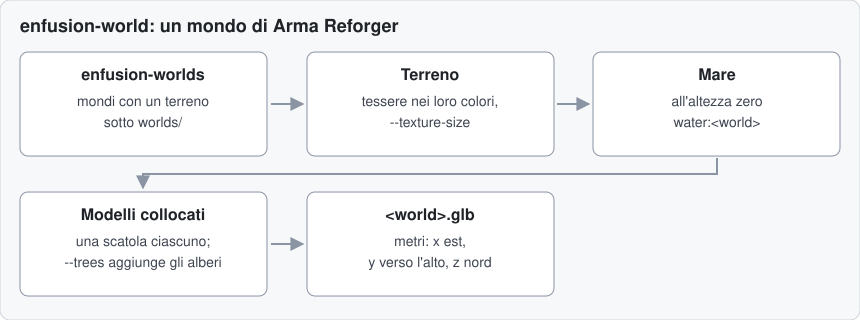

# Mondi di Arma Reforger: `worlds` e `world` {#arma-reforger-worlds-worlds-and-world}

**Che cos'è?** Un intero mondo di Arma Reforger come un unico file 3D. **Perché?** Perché il calore del
gioco abbia sotto di sé il suolo e gli edifici. (*Enfusion* è il motore con cui è fatto Arma Reforger; un
*mondo* è ciò che il gioco chiama mappa.)

Esporta un intero mondo Enfusion di Arma Reforger installato: il terreno nei colori delle sue tessere di
supertexture, il mare, e ogni modello collocato come un riquadro, nei metri propri del gioco. `worlds` e `world`
rispondono anche ai nomi che ha dato loro 3DHeat GameFiles, `enfusion-worlds` ed `enfusion-world`, con le stesse opzioni.



## Passo per passo {#step-by-step}

1. **Elenca i mondi** che hanno un terreno. La prima riga dice dove è stato trovato il gioco:

   ```
   heat3d-reforger-maps worlds
   heat3d-reforger-maps worlds --install "D:\Games\Arma Reforger"
   ```

2. **Esportane uno**, con il nome della sua cartella sotto `worlds/` come elencato:

   ```
   heat3d-reforger-maps world <world> -o world.glb
   ```

3. **Varianti:**

   ```
   heat3d-reforger-maps world <world> --trees               # anche la vegetazione, come riquadri
   heat3d-reforger-maps world <world> --texture-size 0      # solo colore piatto, file piccolo
   heat3d-reforger-maps world <world> --ground-spacing 4 --no-structures
   ```

4. **Apri `world.glb`** nel pannello Sfondo / livello del visualizzatore di 3DHeat ([caricare un livello](https://holdi601.github.io/3DHeat/levels.html)).

## Opzioni {#options}

| Opzione | Predefinito | Significato |
|---|---|---|
| `<world>` | obbligatorio | un mondo come lo stampa `worlds` |
| `-o`, `--out FILE` | `<world>.glb` (in `$HEAT3D_LEVELS/<game>/` quando è impostata) | il file da scrivere |
| `--install FOLDER` | la libreria Steam che contiene il gioco (`steamapps\common\Arma Reforger`) | la cartella del gioco: quella con dentro `addons` |
| `--ground-spacing METRES` | 2 (quello del terreno) | la spaziatura dei vertici del terreno nel file |
| `--texture-size PIXELS` | 4096 | il lato maggiore dell'immagine del colore del suolo; 0 per colore piatto |
| `--no-structures` | | lascia fuori i modelli collocati |
| `--trees` | disattivato | colloca anche alberi e altra vegetazione, come riquadri |

## Esempio di output {#example-output}

`worlds`:

```text
Arma Reforger at D:\Games\Steam\steamapps\common\Arma Reforger: <n> worlds with a terrain
  <world>                                  worlds/<world>/.../<world>.terr
  ...
```

`world`, dopo una riga per passo (`<world>: reading ...`):

```text
<world> -> world.glb
  ground      <n> triangles, <w> x <h> m; <n> of <n> tile-edge vertices disagree; colour <w> x <h>
  structure   <n> boxes from <n> entities
  water       <n> triangles (the sea)
  left out    <what>: <n>, ...
```

## Le parti {#the-parts}

`ground:<world>` (il terreno), `water:<world>` (il mare, ad altezza zero) e `structure:<world>` (i riquadri).
Le coordinate sono quelle del gioco: x verso est, y verso l'alto, z verso nord, in metri - ciò che riporta una
registrazione in gioco. Il sistema di riferimento del gioco è mancino; *Inverti un asse del mondo* nel
visualizzatore lo mostra senza specchiatura.

## Come viene letto e verificato {#how-it-is-read-and-checked}

Non serve Workbench e nulla è cifrato.

| Formato | Che cos'è | Verificato contro |
|---|---|---|
| `.pak` | un blocco di dati e un albero di directory, voci memorizzate o zlib | l'albero usa esattamente il suo blocco; le voci zlib campionate si espandono esattamente alla dimensione dichiarata |
| `.edds` | un'intestazione DDS, poi per ogni livello mip blocchi `COPY` o `LZ4 ` | i livelli a blocchi si decodificano esattamente alla loro dimensione usando esattamente i loro byte |
| `.terr` / `.ttile` | un'intestazione e tessere di altezze a 16 bit | ogni bordo condiviso tra tessere concorda esattamente |
| supertexture | il colore del suolo di ogni tessera, circa un metro per pixel | corrisponde al mare nelle altezze; nessun ribaltamento o trasposizione combacia altrettanto bene |
| `.ent` | nomi, GUID delle risorse, poi entità come valori tipizzati | un file di mondo si analizza fino al suo ultimo byte |
| `resourceDatabase.rdb` | GUID in percorso | quasi ogni GUID usato da un mondo nomina un file che esiste |

Gli oggetti segnati come posti a un'altezza assoluta stanno entro centimetri dal terreno decodificato (con la
griglia trasposta sarebbero a metri di distanza). Non vengono disegnati: i triangoli dei modelli stessi, gli
alberi per impostazione predefinita (`--trees` li aggiunge come riquadri), le entità figlie, laghi e fiumi,
le texture con intestazioni precedenti a DX10.

**Termini:** lo strumento legge i file della tua installazione; il risultato è per uso personale e non va condiviso ([Termini e licenza](terms.md)).

## Messaggi e stato di uscita {#messages-and-exit-status}

| Messaggio | Uscita | Significa |
|---|---|---|
| `Arma Reforger not found; pass --install <game folder>` | 2 | installa il gioco tramite Steam, oppure indica `--install` |
| `no world '<name>'; there are: ...` | 2 | il nome non è uno di quelli che elenca `worlds`; la riga nomina quelli presenti |
| `needs 3DHeat GameFiles: ...` | 2 | installa 3DHeat GameFiles ([Prima di iniziare](before-you-start.md)) |
| qualsiasi altra cosa | 1 | un archivio o un file non ha potuto essere letto; la riga dice quale |

0 significa che il mondo è stato scritto; il suo rapporto inizia con `<world> -> <file>`.

## Tramite 3DHeat GameFiles {#through-3dheat-gamefiles}

I comandi `enfusion-worlds` ed `enfusion-world` di 3DHeat GameFiles lanciano questo strumento con gli stessi
argomenti, quindi `python -m heat3d_gamefiles enfusion-world <world>` fa lo stesso una volta installati entrambi.
