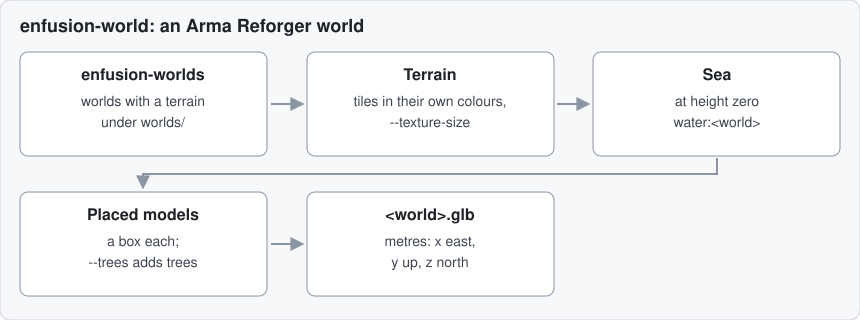

# Arma Reforger worlds: `worlds` and `world`

**What is it?** A whole Arma Reforger world as one 3D file. **Why?** So heat
from the game has the ground and the buildings under it. (*Enfusion* is the
engine Arma Reforger is made with; a *world* is what the game calls a map.)

Exports a whole Enfusion world of the installed Arma Reforger: the terrain in
the colours of its own supertexture tiles, the sea, and every placed model as
a box, in the game's own metres. `worlds` and `world` also answer to the
names 3DHeat GameFiles gave them, `enfusion-worlds` and `enfusion-world`, with
the same options.



## Step by step

1. **List the worlds** that have a terrain. The first line says where the game
   was found:

   ```
   heat3d-reforger-maps worlds
   heat3d-reforger-maps worlds --install "D:\Games\Arma Reforger"
   ```

2. **Export one**, by its folder name under `worlds/` as listed:

   ```
   heat3d-reforger-maps world <world> -o world.glb
   ```

3. **Variations:**

   ```
   heat3d-reforger-maps world <world> --trees               # vegetation too, as boxes
   heat3d-reforger-maps world <world> --texture-size 0      # flat colour, small file
   heat3d-reforger-maps world <world> --ground-spacing 4 --no-structures
   ```

4. **Open `world.glb`** in the 3DHeat viewer's Background / level panel ([loading a level](https://holdi601.github.io/3DHeat/levels.html)).

## Options

| Option | Default | Meaning |
|---|---|---|
| `<world>` | required | a world as `worlds` prints it |
| `-o`, `--out FILE` | `<world>.glb` (in `$HEAT3D_LEVELS/<game>/` when that is set) | the file to write |
| `--install FOLDER` | the Steam library that holds the game (`steamapps\common\Arma Reforger`) | the game's folder: the one with `addons` in it |
| `--ground-spacing METRES` | 2 (the terrain's own) | the terrain's vertex spacing in the file |
| `--texture-size PIXELS` | 4096 | the ground colour image's larger side; 0 for flat colour |
| `--no-structures` | | leave the placed models out |
| `--trees` | off | also place trees and other vegetation, as boxes |

## Example output

`worlds`:

```text
Arma Reforger at D:\Games\Steam\steamapps\common\Arma Reforger: <n> worlds with a terrain
  <world>                                  worlds/<world>/.../<world>.terr
  ...
```

`world`, after a line per step (`<world>: reading ...`):

```text
<world> -> world.glb
  ground      <n> triangles, <w> x <h> m; <n> of <n> tile-edge vertices disagree; colour <w> x <h>
  structure   <n> boxes from <n> entities
  water       <n> triangles (the sea)
  left out    <what>: <n>, ...
```

## The parts

`ground:<world>` (the terrain), `water:<world>` (the sea, at height zero) and
`structure:<world>` (the boxes). Coordinates are the game's own: x east, y up,
z north, in metres - what an in-game recording reports. The game's frame is
left-handed; *invert world axis* in the viewer shows it unmirrored.

## How it is read and checked

No Workbench is needed and nothing is encrypted.

| Format | What it is | Checked against |
|---|---|---|
| `.pak` | a data chunk and a directory tree, entries stored or zlib | the tree uses up its chunk exactly; sampled zlib entries inflate to exactly their stated size |
| `.edds` | a DDS header, then per mip level `COPY` or `LZ4 ` chunks | chunked levels decode to exactly their size using exactly their bytes |
| `.terr` / `.ttile` | a header and tiles of 16-bit heights | every shared tile edge agrees exactly |
| supertexture | each tile's ground colour, about a metre a pixel | it matches the sea in the heights; no flip or transpose fits as well |
| `.ent` | names, resource GUIDs, then entities as typed values | a world file parses to its last byte |
| `resourceDatabase.rdb` | GUID to path | nearly every GUID a world uses names a file that exists |

Objects marked as standing at an absolute height sit within centimetres of the
decoded terrain (with the grid transposed they would be metres off). Not drawn:
the models' own triangles, trees by default (`--trees` adds them as boxes),
child entities, lakes and rivers, textures with pre-DX10 headers.

**Terms:** the game's licence allows non-commercial use and forbids reverse
engineering the game files. Reading your own install is your decision under it;
the output is for your own use and is not to be shared ([Terms and licence](terms.md)).

## Messages and exit status

| Message | Exit | Means |
|---|---|---|
| `Arma Reforger not found; pass --install <game folder>` | 2 | install the game through Steam, or pass `--install` |
| `no world '<name>'; there are: ...` | 2 | the name is not one `worlds` lists; the line names those there are |
| `needs 3DHeat GameFiles: ...` | 2 | install 3DHeat GameFiles ([Before you start](before-you-start.md)) |
| anything else | 1 | an archive or file could not be read; the line says which |

0 means the world was written; its report starts `<world> -> <file>`.

## Through 3DHeat GameFiles

3DHeat GameFiles' own `enfusion-worlds` and `enfusion-world` run this tool
with the same arguments, so `python -m heat3d_gamefiles enfusion-world <world>`
does the same once both are installed.
